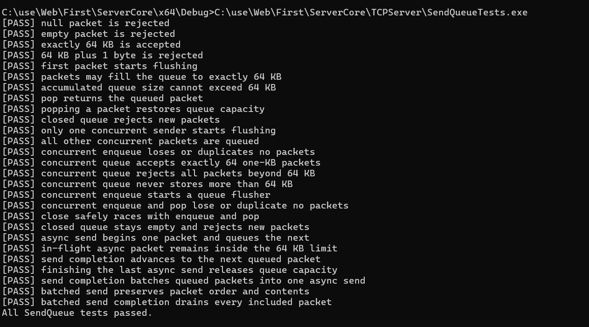
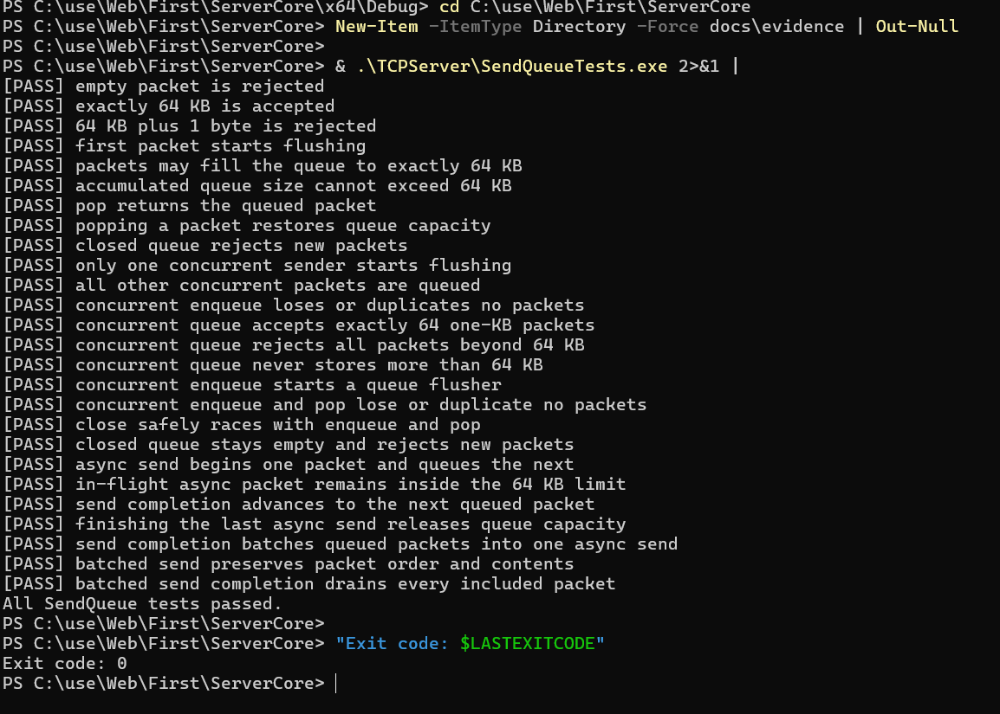
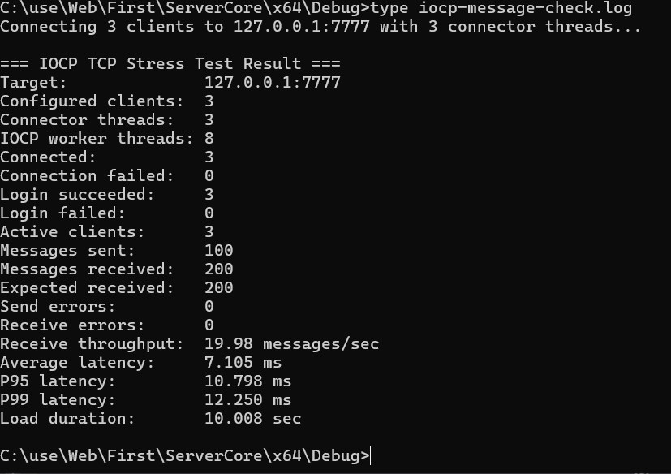

# ServerCore | C++ IOCP 기반 멀티 프로세스 채팅 서버 제작

**접속할 서버를 배정하는 MasterServer, 채팅 연결을 처리하는 GameServer, 채널 간 채팅을 중계하는 WorldServer를 구성했습니다.** Windows C++와 IOCP를 기반으로, 클라이언트부터 서버 간 통신과 부하 테스트 도구까지 구현한 프로젝트입니다.

**멀티 프로세스로 서버 역할을 분리하고, 각 GameServer 내부는 IOCP 기반 멀티스레딩으로 송수신을 처리합니다.** GPT를 활용해 개발했으며, 서버 역할 분리에서 비동기 송수신, 전송 큐 관리, 테스트 도구 구현과 실행 검증으로 작업 범위를 확장했습니다.

| 서버 제작에서 다룬 핵심 | 구현 내용 |
|---|---|
| **여러 서버의 역할 분리** | MasterServer의 등록·접속 배정, GameServer의 세션·채팅, WorldServer의 채널 관리·월드 채팅 |
| **연결별 스레드에서 IOCP로 전환** | 여러 소켓의 완료 이벤트를 worker pool에서 처리하는 비동기 송수신 |
| **전송 완료까지 관리하는 SendQueue** | 전송 중인 데이터까지 64KB 용량에 포함하고, 대기 패킷을 묶어 다음 전송으로 연결 |
| **서버를 확인하기 위한 테스트 도구** | IOCP 기반 부하 생성기와 전송 큐의 동시성·경계 조건 테스트 |

서버 구성은 코드에서 확인한 구현 범위이며, 아래 수치는 실행 기록으로 확인한 결과입니다.

## 구현한 서버를 어떻게 확인했는가

| 확인한 결과 | 증거 |
|---|---|
| **SendQueue 테스트 27개 항목 PASS** | 동시 enqueue/pop, 종료 경합, 64KB 경계, 전송 중 용량 유지, 배치 처리 |
| **테스트 종료 코드 0** | PowerShell 실행 화면 |
| **실제 송신 100개 / 전체 수신 200개** | 로컬 3클라이언트 연결·로그인 성공, 예상 수신량 일치, 송수신 오류 0 |



[테스트 코드](TCPServer/SendQueueTests.cpp) · [원본 실행 로그](docs/evidence/sendqueue-tests.log) · [SendQueue 구현](TCPServer/SendQueue.cpp)

## 이 프로젝트에서 볼 기술 경험

| 경험 | 코드에서 확인할 지점 | 증거 수준 |
|---|---|---|
| **전송 큐의 상태와 용량 관리** | 전송 시작 여부 구분, 전송 완료 시 용량 반환, 대기 패킷 배치 | 코드 + 단위 테스트 로그·사진 |
| **부하 생성기의 IOCP 전환** | 가상 클라이언트별 스레드를 연결 작업자와 수신 worker로 변경 | 변경 전후 코드·문서 + 소규모 통신 결과 |
| **서버의 IOCP 전환** | 세션별 전용 스레드에서 완료 이벤트 기반 처리로 변경 | 변경 전후 코드·커밋 |

## 1. 전송 중인 데이터도 큐 용량에 포함하는 SendQueue

### 구현한 전송 규칙

SendQueue는 AI 생성 코드를 기반으로 구현했습니다. 현재 큐는 mutex 아래에서 입력·종료·전송 상태를 관리하고, 다음 규칙을 적용합니다.

- 전송이 시작된 동안 추가 입력은 큐에 보관합니다. `START_FLUSHING`과 `QUEUED`를 구분해 새 전송 흐름의 시작 여부를 결정합니다.
- 큐에서 꺼내 비동기 전송 중인 데이터도 64KB 누적 용량에 포함합니다. 실제 전송 완료 시 용량을 반환합니다.
- 전송 완료 후 다음 패킷 하나만 꺼내던 코드를, 대기 패킷들을 묶어 다음 전송 버퍼를 만드는 방식으로 변경했습니다.
- 작은 패킷의 배치 기준은 16KB입니다. 첫 패킷 자체가 16KB 이상이면 해당 패킷을 분할하지 않고 단독으로 반환합니다.

```text
Enqueue → 전송 시작 → 완료 이벤트 → 용량 반환 → 대기 패킷 배치 → 다음 전송
```

배치 전송은 대기 패킷 여러 개를 하나의 다음 전송 버퍼로 구성하는 변경입니다. 다만 실제 시스템 호출 감소량과 성능 효과는 아직 측정 결과로 제시하지 않습니다. 16KB가 최적값이라는 근거도 확보하지 않았습니다.

### 확인한 테스트 결과

[보존한 실행 로그](docs/evidence/sendqueue-tests.log)에 **27개 PASS 항목과 `All SendQueue tests passed.`**가 기록되어 있습니다. 첨부된 실행 화면에서도 전체 통과 문구와 종료 코드 `0`을 확인했습니다.


전체 PASS 화면은 문서 상단에, 종료 코드 확인 화면은 아래에 첨부했습니다.

**PowerShell 실행 결과와 종료 코드 0 확인**



동일한 테스트 프로그램을 PowerShell에서 실행한 화면입니다. 상단 첫 PASS 항목은 화면에 보이지 않지만, 최종 통과 문구와 종료 코드 `0`이 보입니다.

테스트 범위는 다음과 같습니다.

| 검증 대상 | 로그에 기록된 결과 |
|---|---|
| 잘못된 입력과 용량 경계 | null·빈 입력 거부, 정확히 64KB 허용, 초과 입력 거부 |
| 동시 입력·출력 | 동시 enqueue 및 enqueue/pop에서 누락·중복 검사 통과 |
| 종료 경합 | close와 enqueue/pop 경합 테스트 통과 |
| 비동기 전송 상태 | 전송 중인 데이터 용량 유지, 완료 후 다음 전송 및 용량 반환 |
| 배치 전송 | 패킷 묶음 구성, 순서 확인, 완료 후 큐 비우기 |

**근거:** 초기 큐 구현 커밋 `9d734f8`, IOCP 전환 커밋 `f817a2c`, 배치 전송 커밋 `30d1901`, [SendQueue.cpp](TCPServer/SendQueue.cpp), [SendQueueTests.cpp](TCPServer/SendQueueTests.cpp).

**확인 범위:** `TCPServer/SendQueueTests.exe` 실행 화면과 원본 로그로 확인한 단위 테스트 결과입니다. 해당 실행 파일의 빌드 버전과 현재 소스의 일치 여부는 별도로 확인하지 않았습니다. 실제 네트워크의 모든 수신자에게 누락·중복 없이 전달된다는 증명과는 구분합니다. 실제 동시 송신 오류를 직접 경험했다는 사실도 확인되지 않았으므로 실패 경험으로 서술하지 않습니다.

## 2. 부하 생성기의 스레드 구조까지 바꾼 테스트 환경

### 서버뿐 아니라 테스트 도구의 구조도 변경

초기 `TCPStressClient`는 가상 클라이언트마다 `std::thread`를 생성했습니다. `0646ea7`에서 소수의 연결 작업자와 IOCP 수신 worker가 여러 가상 소켓을 처리하도록 변경했습니다.

기존 [성능 측정 문서](docs/performance-capacity-test.md)에는 2,100명 연결을 설정했지만 실제 연결 수가 부족했고, 이를 서버의 2,100명 처리 실적으로 사용하지 않겠다고 기록되어 있습니다. 이후 IOCP 부하 생성기에서 1,200명 연결·로그인 성공을 기록했습니다. 이 수치는 원본 실행 로그를 확인하지 못했으므로 아래 검증 결과에는 포함하지 않습니다.

**근거:** 커밋 `0646ea7`의 변경 전후 코드와 문서, [TCPStressClient.cpp](TCPStressClient/TCPStressClient.cpp).

### 현재 남아 있는 실제 통신 결과

로컬 서버 `127.0.0.1:7777`에 클라이언트 3개를 연결하고, 그중 1개가 초당 10개씩 약 10초간 채팅을 보내는 테스트 기록입니다. 서버는 송신자를 제외한 나머지 클라이언트에 채팅을 전달하므로 송신 100개의 예상 수신 총합은 200개입니다.

| 항목 | 첫 실행 | 두 번째 실행 |
|---|---:|---:|
| 연결 성공 / 실패 | 3 / 0 | 3 / 0 |
| 로그인 성공 / 실패 | 3 / 0 | 3 / 0 |
| 송신 메시지 | 100 | 100 |
| 실제 / 예상 수신 | 200 / 200 | 200 / 200 |
| 송신 / 수신 오류 | 0 / 0 | 0 / 0 |
| 평균 지연 | 7.672ms | 7.105ms |
| P95 / P99 지연 | 11.379 / 11.717ms | 10.798 / 12.250ms |
| 부하 시간 | 10.001초 | 10.008초 |



연결·로그인 3/3 성공, 송신 100개에 대한 전체 수신 200개 일치, 송수신 오류 0개를 확인한 실행 화면입니다.

**원본:** [iocp-basic.log](docs/evidence/iocp-basic.log), [iocp-message-check.log](docs/evidence/iocp-message-check.log).

이 결과는 실제 서버의 전송 큐·비동기 송신·클라이언트 수신 경로를 사용한 테스트입니다. 두 로그 모두 전체 수신 개수를 집계하며, 파일명과 관계없이 수신자별 메시지 순번 검사는 수행하지 않습니다. 따라서 확인된 결과는 **이 조건에서 연결·로그인이 성공했고 전체 수신량이 예상과 일치했다**는 범위입니다.

## 3. 서버의 실행 구조도 세션별 스레드에서 IOCP로 전환

### 변경 전과 변경 후

기존 서버에는 클라이언트마다 전용 스레드를 생성하는 구조가 있었습니다. `f817a2c`에서 전용 스레드를 제거하고, 여러 소켓의 완료 이벤트를 IOCP와 worker pool에서 처리하도록 변경했습니다. 기존 `SendAll` 호출 경로도 비동기 `WSASend` 기반 처리로 바뀌었습니다.

```text
변경 전: 클라이언트별 전용 스레드 + 블로킹 송신 경로
변경 후: IOCP 완료 큐 + worker pool + WSARecv / WSASend
```

이 변경의 핵심은 연결마다 실행 스레드를 추가하던 구조에서 소켓 완료 이벤트를 worker가 처리하는 구조로 바꾼 점입니다. 비동기화에 따라 수신 데이터의 패킷 분리, 부분 송신 처리, 전송 버퍼 수명도 완료 처리 경로에서 관리합니다.

**근거:** 커밋 `f817a2c`, [IocpCore.cpp](TCPServer/IocpCore.cpp), [Session.cpp](TCPServer/Session.cpp), [IocpEvent.h](TCPServer/IocpEvent.h).

**확인 범위:** 구조 변경은 코드로 확인할 수 있습니다. 동일 조건의 변경 전후 성능 측정 자료는 확보하지 않았으므로, 처리량 증가율이나 지연시간 개선율을 주장하지 않습니다.

## 함께 구현한 서버 구성

`Project1.sln`에는 GameServer(`TCPServer`), `TCPClient`, `MasterServer`, `WorldServer`, `TCPStressClient`, `SendQueueTests`가 있습니다.

- GameServer: 연결·로그인·채팅, 실행 인수에 따른 서버 ID·포트·worker 설정
- MasterServer: 서버 등록·Heartbeat 상태 관리, 활성 서버 중 접속자가 적은 GameServer 배정
- WorldServer: 채널 등록·상태 관리와 월드 채팅 중계
- DBConnect: 환경변수 기반 MySQL 연결, 스키마 선택, `SELECT 1` 확인
- 실행 스크립트: 다중 GameServer 및 클러스터 실행·종료·동시 부하 테스트

위 항목은 현재 코드에서 확인한 구현 범위입니다. 서버 배정·Heartbeat 장애 처리·월드 채팅·DB 연결의 실행 검증 결과는 이 README의 성과 수치에 포함하지 않습니다. 구성과 실행 방법은 [멀티 프로세스 문서](docs/multi-process-game-servers.md)에 정리되어 있습니다.

## AI 활용과 기여 범위

GPT를 활용해 구현을 진행했으며, SendQueue는 AI 생성 코드 기반 구현입니다. 프로젝트의 구조 변경과 테스트 자료는 위 코드·커밋·로그에 연결했습니다. 현재 자료만으로 각 코드의 직접 작성 범위나 당시 설계 판단을 모두 복원할 수 없으므로, 이를 독자 설계·단독 구현 경험으로 표현하지 않습니다.

이 문서에는 구현 이력과 남아 있는 실행 결과만 담았습니다. 수신자별 메시지 정확성, 배치 전송의 성능 효과, 최대 동시 접속 성능은 아직 완료한 성과에 포함하지 않습니다.

